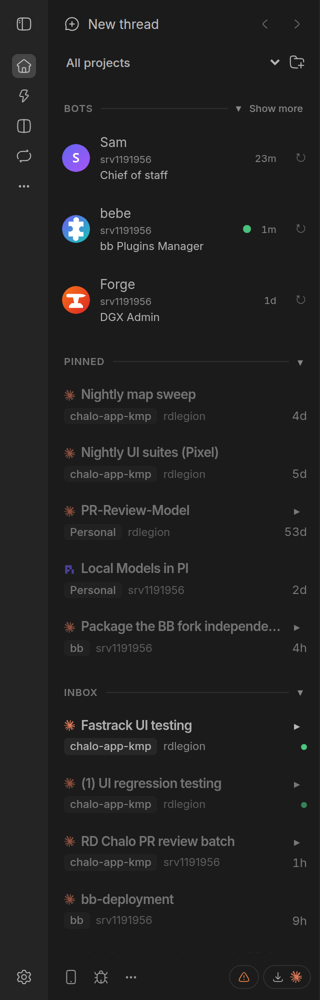

# rd-bb-plugins

Personal plugins for [bb](https://github.com/ymichael/bb).

## Plugins

- [`bb-plugin-assistants`](./bb-plugin-assistants) — your assistants in the sidebar: a Bots row per assistant above the inbox, conversations that move between machines, and endless memory. Needs a `bb-sw-pipeline` checkout beside this repo (its inbox-core is a file dependency); see the plugin README for setup.
- [`bb-plugin-private-sync`](./bb-plugin-private-sync) — sync private folders through your BB server, with per-machine paths, exclusions, and preserved conflicts.
- [`bb-plugin-usage`](./bb-plugin-usage) — view Codex and Claude Code subscription usage.
- [`bb-plugin-claude-accounts`](./bb-plugin-claude-accounts): switch Claude Code accounts on selected machines from any BB browser.
- [`bb-plugin-favorites`](./bb-plugin-favorites) — save machine / harness / model setups and open New Thread already set to them.

## Development

Assistants and Private Sync use the published `@get-bb/plugin-sdk` package.
See each plugin's README for installation, tests, and builds.

Plugins using shared BB SDK declarations in `types/` can refresh them after
updating bb:

```sh
npm run update-bb-types
```

## Screenshots




